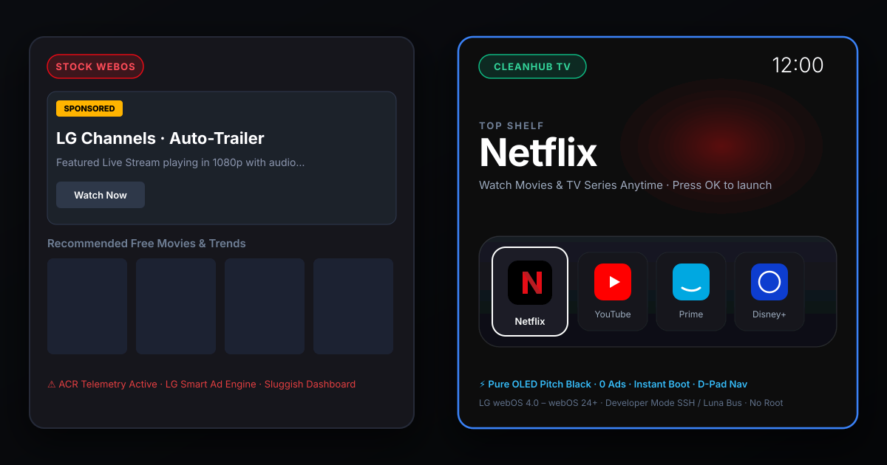
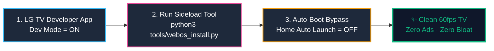

<div align="center">

# 📺 CleanHub TV (LG webOS Edition)
### The Open-Source, Ad-Free, 60fps Replacement for LG webOS Home Dashboard

[](https://github.com/smartjaganrao/cleanyourtv-webos/releases/latest)
[](docs/CCTV_MONITOR.md)
[](#-retro-arcade-4k--gamepad-drift-hub)
[](docs/ADFREE_YOUTUBE.md)
[](docs/ART_MODE.md)
[](docs/LIVETV.md)
[](LICENSE)

<br>



<br>
<br>

**CleanHub TV** is the ultimate open-source alternative to LG's bloated webOS home dashboard. It replaces intrusive banner ads, sponsored video trailers, and system lag with a hardware-accelerated **Apple TV-style glass interface** running at a locked **60fps**.<br>
Includes **4-Channel CCTV Surveillance Quad Grid**, **Built-in 60fps Retro Arcade**, **Zero-Latency Gamepad Stick Drift Radar**, **Ad-Free YouTube with SponsorBlock**, free **"The Frame" 4K Ambient Art Mode**, **350+ Free Live World IPTV Channels**, **1-Click Bedtime Sleep Timer**, **24/7 Lo-Fi Radio with OLED Screen-Off**, and **TV Speed Diagnostics**.

*Runs on any LG Smart TV running webOS (webOS 4.0 – webOS 24+) · OLED (C/G/B/M Series) · QNED · NanoCell · 4K UHD · Zero Root Required*

<br>

[⚡ Why CleanHub TV](#-why-cleanhub-tv-save-450year) •
[🚀 2-Min Install](#-2-minute-quick-start) •
[📹 4-Cam CCTV](#-4-channel-cctv-surveillance-quad-grid) •
[🕹️ Retro Arcade](#-retro-arcade-4k--gamepad-drift-hub) •
[📺 Ad-Free YouTube](#-ad-free-youtube--sponsorblock) •
[📡 Live IPTV](#-free-live-world-iptv--custom-m3u) •
[🖼️ Art Mode](#️-the-frame-ambient-art-mode) •
[🛠️ Power Tools](#️-essential-tv-power-tools) •
[🎮 Remote Cheat Sheet](#-remote--gamepad-navigation-cheat-sheet)

</div>

---

## ⚡ Why CleanHub TV? (Save $450+/Year)

Retail LG Smart TVs inject banner advertisements into the home dashboard, auto-play sponsored trailers with sound, secretly track every HDMI input using Automatic Content Recognition (ACR), bury the sleep timer 6 submenus deep, forbid retro emulators, and charge $4.99/month for art subscriptions. Third-party IPTV apps charge $15–$35 activation fees, while YouTube Premium costs $13.99/month.

**CleanHub TV eliminates the bloat and provides an open-source, private, hardware-accelerated dashboard:**

| Feature / Paid Service | Typical Paid Solution | CleanHub TV LG webOS | Annual Savings |
| :--- | :--- | :--- | :--- |
| 📹 **4-Channel CCTV Surveillance** | Commercial NVR / Paid Monitoring Apps ($100–$250) | **100% Free Built-in** (2x2 Quad Grid + 1080p zoom + Tapo/Hikvision/CP Plus/Frigate) | **$100 – $250** |
| 🕹️ **Retro Arcade & Game Engine** | Raspberry Pi 4 / Retro Box ($60 – $120) | **100% Free Built-in** (5 games + 60fps canvas + 8-bit synth + ROM loader) | **$60 – $120** |
| 🎯 **Gamepad & Stick Drift Radar** | Third-party PC calibration software | **100% Free** (Zero-latency drift radar, trigger gauges & dual rumble) | **Priceless** |
| 📺 **Ad-Free YouTube + SponsorBlock** | YouTube Premium ($13.99/mo) | **100% Free** (Zero video ads + auto SponsorBlock + 4K HDR 60fps) | **$168 / yr** |
| 📡 **Live World IPTV Player** | Smart IPTV / IBO Player ($8 – $35 activation) | **100% Free** (350+ global streams + Custom M3U + Favorites) | **$15 – $35** |
| 🖼️ **Ambient Art Mode** | Samsung Art Store on The Frame ($4.99/mo) | **100% Free** (4K Museum Masterpieces + OLED Burn-in Protection) | **$60 / yr** |
| 🎵 **24/7 Lo-Fi & Background Music** | Spotify / Apple Music TV ($10.99/mo) | **100% Free** (5 commercial-free radio streams + OLED screen-off) | **$132 / yr** |
| ⏱️ **1-Click Bedtime Sleep Timer** | Buried in 6 LG TV submenus | **1-Click Remote Toggle** (15m, 30m, 45m, 60m, 90m, 120m) | **Priceless** |
| ⚡ **TV Network Speed & Buffer Test** | Sluggish TV browser / ad-filled apps | **Instant 1-Click Test** (Cloudflare edge CDN throughput & 4K latency) | **Included** |
| 🎬 **Free Cinema & VOD Hub** | Scattered apps with slow loading | **One-Tap Access** (Curated Pluto, Tubi, FilmRise, LG Channels) | **Included** |
| 🛡️ **Ad & Telemetry Blocker** | AdGuard DNS VIP / NextDNS Pro ($20 – $40/yr) | **Included Free** (75+ LG webOS ad & ACR domains blocked at DNS level) | **$20 – $40** |
| 📱 **Smartphone Web Remote** | Paid App Store TV Remotes ($9.99 – $29.99) | **Included Free** (Scan QR code on TV for instant mobile trackpad) | **$10 – $30** |
| 💰 **Total Annual Cost** | **$550 – $750 / year** | **$0.00 (Free & Open Source)** | **Save $500+/yr** |

> [!NOTE]
> CleanHub TV installs as an authorized user-space application via LG's official Developer Mode API. It requires **no rooting**, **no hardware flashing**, and does **not void your warranty**.

---

## ✨ Features at a Glance

```
┌──────────────────────────────────────────────────────────────────────────────────┐
│ [Arcade]  [Live TV]  [CCTV]  [Art]  [Lo-Fi]  [Sleep: Off]  [Inputs]  [⚙️]  12:00 │
│                                                                                  │
│                                RETRO ARCADE 4K                                   │
│                             Press OK to launch                                   │
│                                                                                  │
│    ╭──────╮      ╭──────╮      ╭──────╮      ╭──────╮      ╭──────╮      ╭──────╮│
│    │ARCADE│      │  YT  │      │  N   │      │ CCTV │      │HOTSTAR│     │HDMI 1││
│    ╰──────╯      ╰──────╯      ╰──────╯      ╰──────╯      ╰──────╯      ╰──────╯│
│       ▲             ▲             ▲             ▲             ▲             ▲    │
│   (Apple TV-style glass dock with fluid floating physics highlight)              │
└──────────────────────────────────────────────────────────────────────────────────┘
```

- **🚀 60fps Native webOS Web App (`.ipk`):** Sub-50ms cold-start written in pure vanilla HTML5/CSS3/ES6. Zero npm runtime bloat. Runs at locked 60fps across all LG OLED and UHD chipsets.
- **📹 4-Channel CCTV Surveillance Matrix:** 2x2 multi-camera live grid with 1-click 1080p full-screen zoom, 10s auto-patrol tour, and remote number key switching (1-4). Supports RTSP-over-HLS, NVRs, Tapo, Hikvision, CP Plus, and HTTP snapshots.
- **🕹️ 60fps Web Retro Arcade:** 5 built-in playable retro classics (Brick Breaker 4K, Space Defenders 1984, Cyber Snake, Retro Pong Pro 2-player, Falling Blocks Tetriminos) with Web Audio 8-bit synth and CRT monitor filter.
- **🎯 Gamepad Input & Stick Drift Radar:** Zero-latency HTML5 Gamepad HUD for PS5 DualSense, PS4, Xbox Wireless, and 8BitDo controllers. Detects analog stick drift with deadzone radar rings (5%, 15%) and dual-rumble vibration tests.
- **🛋️ Couch Gamepad & Magic Remote Navigation:** Navigate the entire dashboard effortlessly using your LG Magic Remote gyro pointer, D-pad, or paired Xbox/PlayStation controller.
- **📺 Ad-Free YouTube (Homebrew + SponsorBlock):** Blocks all video ads, auto-skips sponsored segments, and provides 4K HDR 60fps playback with background audio support.
- **🖼️ "The Frame" Ambient Art Mode:** Transforms your living room into an art gallery with 4K public domain museum masterpieces (Van Gogh, Monet, Vermeer, Hokusai, NASA JWST) and active OLED pixel-shift burn-in protection.
- **📡 Free Live World IPTV (iptv-org):** 350+ curated, tested, geo-unblocked live streams across 26 countries (News, Sports, Movies, Animation, Kids).
- **⏱️ 1-Click Bedtime Sleep Timer:** Replaces LG's 6-step buried menu with a simple 1-click toggle (`15m` · `30m` · `45m` · `60m` · `90m` · `120m`) featuring on-screen countdown and soft screen shutdown.
- **🎵 24/7 Lo-Fi & Background Music:** Commercial-free stream radio stations with real-time audio visualizer and **OLED Screen-Off mode** (turns off 100% of panel pixels while keeping sound playing).
- **⚡ TV Network Speed & Buffer Diagnostic:** Direct Cloudflare CDN edge speed test measuring actual download bandwidth, ping latency, and 4K HDR buffer health in seconds.
- **🎬 Free Cinema & VOD Hub:** 1-tap fast access to legal free on-demand movie & TV services (Pluto TV, Tubi, FilmRise, LG Channels).
- **📂 Custom M3U & Xtream Codes Support:** Load your own private M3U/M3U8 playlists or free community feeds with 1-click **Favorites (`★`)**.
- **📱 Zero-Install Mobile Web Remote:** Scan a TV QR code with your phone to use a mobile keyboard and trackpad over local Wi-Fi without installing any app.

---

## 🚀 2-Minute Quick Start



### Step 1: Turn on Developer Mode on your LG TV
1. Open the **Apps** (LG Content Store) on your LG TV.
2. Search for **Developer Mode** and install the official app by LG Electronics.
3. Log in with a free LG Developer account.
4. Toggle **Dev Mode Status = ON** and **Key Server = ON**.

### Step 2: Sideload CleanHub TV from your computer

```bash
# 1. Clone the repository
git clone https://github.com/smartjaganrao/cleanyourtv-webos.git
cd cleanyourtv-webos

# 2. Probe TV connection on local Wi-Fi
python3 tools/lg_tv.py probe <TV_IP>

# 3. Package and sideload CleanHub TV to your TV (Automatic!)
python3 tools/webos_install.py <TV_IP>

# 4. (Optional) Sideload Ad-Free YouTube + SponsorBlock
python3 tools/install_youtube_adfree.py <TV_IP>

# 5. Silence LG ads & ACR telemetry tracking
python3 tools/debloat_dns.py --check
```

> [!TIP]
> **Prefer pre-built binaries?** You can download the latest pre-compiled [`com.cleanyourtv.home_1.5.0_all.ipk`](https://github.com/smartjaganrao/cleanyourtv-webos/releases/latest) directly from GitHub Releases and install using `webos_install.py` or `ares-install`.

### Step 3: Set Auto-Boot Bypass
On your TV:  
`Settings → General → System → Additional Settings → Home Settings`  
- Set **Home Auto Launch = OFF**  
- Set **Home Promotion = OFF**  
*(Now whenever your TV powers on, it opens directly into CleanHub TV without showing LG's home screen!)*

---

## 📹 4-Channel CCTV Surveillance Quad Grid

CleanHub TV includes a high-definition CCTV security monitor directly accessible from the launcher:
- **Quad 2x2 Grid**: View 4 live security camera feeds simultaneously.
- **1-Click Fullscreen**: Click any camera or press **OK** to zoom into 1080p full screen.
- **Number Shortcuts**: Press **`1`**, **`2`**, **`3`**, or **`4`** on your remote to jump straight to that camera. Press **`0`** or **`Back`** to return to Quad View.
- **Remote Configuration**: Press the **Blue** button to configure custom RTSP-over-HLS, NVR, Tapo, Hikvision, CP Plus, or HTTP snapshot URLs directly on-screen.

---

## 🎮 Remote & Gamepad Navigation Cheat Sheet

| Button | Action in CleanHub TV |
| :--- | :--- |
| **`D-Pad` / `Left Stick`** | Navigate between apps, dock, and top header pills |
| **`OK` / `Enter` / `A` / `✕`** | Launch focused application / Open selected modal |
| **`Back` / `ESC` / `B` / `◯`** | Close modal / Return to Dock / Exit Fullscreen |
| **`Red` Button** | Instant Fullscreen Live TV toggle |
| **`Green` Button** | Toggle CCTV 10-Second Auto-Tour Patrol / Ambient Art Mode |
| **`Yellow` Button** | Open TV Network Speed & Buffer Diagnostic |
| **`Blue` Button** | Open CCTV Security Camera Monitor & Stream Settings |
| **`Numbers 1–4`** | Direct switch to CCTV Camera 1, 2, 3, or 4 |
| **`Number 0`** | Return to CCTV Quad View / All Channels Lineup |
| **`Magic Remote Wheel`** | Scroll smoothly through All Applications grid |

---

## 🛡️ License

CleanHub TV (LG webOS Edition) is free, open-source software released under the [MIT License](LICENSE). Built for the smart TV community with zero corporate bloat.
